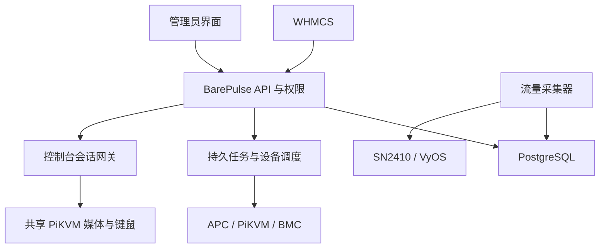
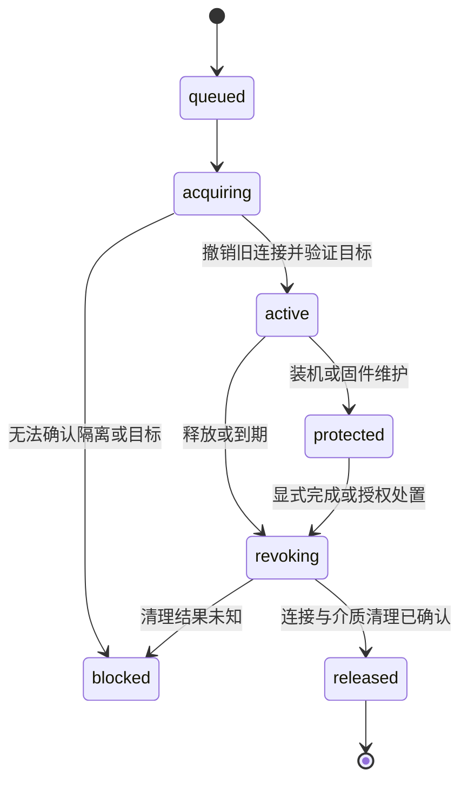

# BarePulse 物理服务器管理平台开发计划

版本：规划 v0.1 · 整理日期：2026-10-15（Asia/Shanghai）

状态：需求基线与实现方案；尚未进入实机联调。

本文汇总 2026-10-14 至 2026-10-15 的物理服务器、流量、电源和定制 PiKVM 讨论，并补充便于开发落地的数据模型、任务流程及验收条件。PiKVM 的具体接口与证据见 [接入细节](pikvm-integration.md)。本文中的 API、表名和状态机均为 BarePulse 设计草案，不表示现有设备提供同名能力。

## 1. 项目定位与证据等级

BarePulse 面向约 30 台异构物理服务器，提供独立、轻量的基础设施管理能力。管理员在 BarePulse 维护设备与绑定关系；WHMCS 负责业务服务及账单，通过 BarePulse API 查询状态、发起电源任务和申请控制台。

| 标记 | 含义 |
| --- | --- |
| 已确认需求 | 用户明确提出的功能、设备环境或约束 |
| 静态已确认 | 已从上传手册、设备源码、配置或命令输出核对；不等于运行验证 |
| 建议实现 | 为实现需求提出的架构、字段、默认值和开发安排；可在实施时调整 |
| 待验证／待确定 | 缺少实机证据，或业务规则尚未确认；不得默认为已支持 |

本计划建立时完成的是资料整理；后续收到编码任务，可按 [开发流程](development-workflow.md) 和 [AGENTS.md](../AGENTS.md) 持续实施代码、模拟测试和本地集成。之前“只读，不执行设备控制”的设备边界继续有效；不得因文档列出接口或收到持续编码要求就调用生产设备。

## 2. 已确认环境与需求

### 2.1 设备基线

以下是讨论时用户提供的环境记录，后续接入时应重新登记实际固件和能力。

| 对象 | 已知型号／版本／规模 | 用途与约束 |
| --- | --- | --- |
| 物理服务器 | 初期约 30 台 | 通常一台服务器对应一个交换机端口；允许多台处于同一 VLAN |
| 交换机 | Mellanox SN2410；Onyx 3.9.3202；BIOS 4.6.5 | 按物理端口统计流量 |
| 路由器 | VyOS 1.5.0 | 按 VLAN 接口统计流量，与端口口径区分 |
| PDU | APC AP7921B | 为接在其插座上的服务器提供供电控制／重启 |
| 铭凡设备 | 接 APC，上层存在 ATS，设置来电自启 | PDU 断电再送电后，是否实际启动还需验证；ATS 不作为客户控制对象 |
| DIY 服务器 | 5950X／9950X 等 | 通过定制 PiKVM 与主板控制模块接入 |
| 定制 PiKVM | 16 个端口，多台服务器共享 | 同一时间仅能使用一个控制台目标；不能向不同客户同时分配不同端口的独立画面 |
| TYAN／Dell R750 | IPMI／iDRAC | 具体固件、授权、Redfish、远程控制台能力尚待登记 |
| 业务系统 | WHMCS | 通过平台标准 API 集成，不直接保存设备凭据 |

### 2.2 必须覆盖的业务场景

| 编号 | 已确认需求 | 对应设计 |
| --- | --- | --- |
| R01 | 轻量的独服流量与电源平台 | 独立后端、管理界面、采集器、任务执行器 |
| R02 | SN2410 端口和 VyOS VLAN 流量采集 | 可选择主计量来源，保留辅助观测来源 |
| R03 | 同 VLAN 的多台服务器可共享额度，也可各自独立 | 独立的流量账户，不以 VLAN 直接等同客户或额度账户 |
| R04 | 接入 APC PDU 重启 | 插座与供电路径绑定、硬断电动作显式标识 |
| R05 | DIY 服务器通过定制 PiKVM 管理电源 | 逐端口电源驱动、参数校验、状态复核 |
| R06 | TYAN／R750 使用 IPMI／iDRAC | 按能力声明接入，避免统一按钮掩盖行为差异 |
| R07 | 多台共享一套 16 口 KVM，只有一个控制台目标 | 设备级独占、排队、撤销旧连接、装机占用 |
| R08 | 提供标准 API 供 WHMCS 调用 | 服务映射、权限校验、异步任务及短期控制台凭证 |
| R09 | 当前仅阅读设备资料，不执行控制动作 | 开发与生产联调分离，设备调用默认关闭 |

### 2.3 首期边界

首期交付：资产和绑定、流量图与额度、三类电源驱动、共享控制台会话、审计和 WHMCS 接入。

以下尚未确认为首期必做：超额自动限速／断网、自动超额收费、95th 百分位计费、自动 PXE 重装、自动刷 BIOS、完整 IPAM、BGP/RTBH 配置、HA 和多站点调度。可保留扩展接口，但不把其它虚拟化或账单项目的需求自动合并进来。

通过虚拟介质手动安装系统、进入 BIOS 与“全自动重装系统”是不同交付项。首期需保护装机占用，自动重装另立范围。

## 3. 建议架构

运行架构、开发阶段依赖及持续实现循环的详细图见 [开发流程与架构图](development-workflow.md)。该文档细化执行方法；本计划继续作为功能范围和业务约束的基线。

### 3.1 技术栈与进程

前文提出过 Go + PostgreSQL + Docker Compose；目前未检索到用户最终锁定技术栈的明确决定，本文将其保留为建议基线。

| 组件 | 建议 | 说明 |
| --- | --- | --- |
| 后端 | Go，模块化单体 | 统一 API、驱动接口、权限、任务与会话逻辑 |
| 数据库 | PostgreSQL | 资产、额度账本、任务、会话、采样分区和审计 |
| 前端 | 独立管理界面；具体框架待实现时选择 | 优先清晰的资产、流量、电源与控制台流程 |
| 采集器 | 独立 worker 或同程序不同运行模式 | 定时采集、失败隔离、批量获取已绑定计数器 |
| 电源执行器 | 持久任务 + 每设备单一活动执行者 | 防止重试和多实例造成重复设备命令 |
| 控制台网关 | HTTP / WebSocket / 媒体代理 | 对每个会话检查租约和目标；可主动关闭长连接 |
| 部署 | Docker Compose | 初期按规模简化部署；先不强制引入 Redis、消息总线或 Kubernetes |

API、采集与设备执行逻辑应可独立测试。运行时拥有网络访问权限的执行器只访问登记的设备，不接收客户端任意目标地址或 Shell 命令。

### 3.2 驱动拆分

- `TrafficCollector`：发现接口、读取计数器、记录状态与采样质量。
- `PowerDriver`：声明能力、读取状态、提交动作、解释命令结果。
- `ConsoleDriver`：选择目标、读取当前目标、连接／撤销媒体与 HID。
- `MediaDriver`：挂载与卸载虚拟介质；与控制台共享资源锁。
- `NetworkPolicyDriver`：预留后续网络限制能力；首期不启用写配置。

同一台 PiKVM 的电源和控制台可分为两个逻辑驱动，但必须共用设备调度器与必要的互斥／冷却状态。

## 4. 资产、绑定与权限

### 4.1 管理对象

服务器记录包括资产编号、机型、CPU／内存／磁盘、机房机柜、业务归属、IP 地址备注、维护状态和设备能力。IP 地址用于展示或辅助观测，不以 Ping 是否可达直接决定电源状态。

绑定关系至少包括：

- 服务器 → SN2410 物理接口，可扩展多接口／LAG。
- 服务器 → VLAN；一个 VLAN 可有多台服务器。
- 服务器 → 流量账户，账户可以包含一台或多台服务器。
- 服务器 → 电源驱动、PiKVM 端口／PDU 插座／BMC 系统目标。
- 服务器 → 控制台设备与端口，可能与电源来源不同。
- WHMCS 服务 → BarePulse 服务器与授权主体。

绑定须记录生效时间与历史版本。任务入队时保存绑定版本，执行前再次核对；若服务器已换客户或换端口，旧任务不得操作新目标。流量历史按当时的绑定归属，不因换绑重写旧账。

### 4.2 角色与页面

| 角色 | 可访问内容 | 限制 |
| --- | --- | --- |
| 平台管理员 | 资产、绑定、凭据引用、额度政策、设备维护、审计 | 危险操作留痕；不能绕过装机占用而静默切换 |
| 运维人员 | 授权范围内的诊断、任务和控制台 | 按角色授予维护能力，不默认拥有全部凭据 |
| 客户 | 自己服务的流量、状态、电源任务与控制台 | 不能指定设备端口、插座、目标 URL 或直接访问管理面 |
| WHMCS 集成身份 | 指定服务映射内的 API | 不能仅凭浏览器提交的 server_id/client_id 执行操作 |

管理界面提供服务器列表、设备列表、流量账户、任务中心和控制台占用视图。客户产品详情页提供流量图、额度、数据更新时间、明确的电源状态、支持的操作按钮、任务进度和控制台排队状态。

共享额度跨多个服务展示时，必须按权限隐藏其他客户资产；默认建议同一归属下共享，跨客户共享需另行明确规则。

## 5. 流量采集与额度核算

### 5.1 采集来源与方向

SNMP 是建议的首选采集方式，优先只读 SNMPv3。实际设备是否已开启、可用算法及 MIB 支持需在授权的接入阶段核实。不要以配置网页或全量 SSH 输出作为稳定计量协议。

建议以 60 秒为初始采样周期，后台可调；这来自前文方案建议，不是已部署设置。应核对 Onyx 的数据刷新／缓存周期，避免更高频轮询只得到重复缓存值。

| 来源 | 典型用途 | 客户方向映射及限制 |
| --- | --- | --- |
| SN2410 直连服务器端口 | 单服务器独立额度，或多端口汇入共享账户 | 通常交换机端口 RX 为服务器上传，TX 为服务器下载；必须按实际连接校核 |
| VyOS 客户侧 VLAN 子接口 | 整个 VLAN 的统一额度或交叉核对 | 通常路由器 RX 为该 VLAN 上传，TX 为下载；以接口位置确认 |
| LAG／桥／父接口／子接口 | 后续扩展 | 同一批流量只选一个统计层级，不叠加父接口与成员接口 |

端口统计可能包含同 VLAN 内部流量；路由器 VLAN 计数未必包含同 VLAN 二层互访，也不能天然等同“公网流量”。如果业务只计公网流量，需另行设计能区分路径的采集点。端口总和与 VLAN 总量有差异时先解释口径，不自动补差计费。

### 5.2 共享与独立额度

| 场景 | 账户与主计量来源 | 规则 |
| --- | --- | --- |
| 同 VLAN 三台，各自独立额度 | 三个账户，各自绑定服务器物理端口 | VLAN 总数仅观测，不重复入账 |
| 同 VLAN 三台，共享额度 | 一个账户，聚合三个端口 | 所有成员消耗同一额度；内部流量按端口口径处理 |
| 整个 VLAN 共享一个额度 | 一个账户，以 VLAN 接口计量 | 不再叠加服务器端口；无法据此准确拆成三份独立使用量 |
| 共享 VLAN 中有非账户成员 | 优先成员端口聚合 | 不能把整个 VLAN 流量都算给该账户 |

每个账户／时间段选择一套权威计量来源，其它来源为观测。使用源集合、绑定生效区间和去重键防止重复入账。同 VLAN 不是共享额度的充分条件，是否共享由账户关系决定。

### 5.3 计数器处理

按 IF-MIB 读取 64 位 `ifHCInOctets`、`ifHCOutOctets`，并记录 `ifIndex`、`ifName`、`ifAlias`／`ifDescr`、`sysUpTime`、`ifCounterDiscontinuityTime` 及必要的链路状态。以设备和稳定接口标识关联，不永久假设 ifIndex 不变。[T1]

正常区间的差值为本次累计值减上次累计值；平均 bps 为差值 × 8 ÷ 实际间隔秒数。计数器复位、接口重建、设备重启、负差值或无法解释的异常跳变时建立新基线，并标记区间质量，不把负值取绝对值，也不直接当成正常回绕。

采集失败不能写成“流量为零”。短暂漏采后若计数器连续，可以恢复整个间隔的总量，但不能伪造分钟级走势。若跨越结算边界且无法精确拆分，标记估算／缺口并采用已确定规则，不能悄悄分摊。首次采样只建立基线。

原始样本和额度账本分开保存。建议唯一键覆盖设备、接口、采样周期及绑定版本；作业重跑不重复累计。API 的大整数累计字节使用十进制字符串等无精度损失格式。

### 5.4 额度政策与超额

以下业务选项尚待确定；设计时支持配置，不擅自视为既定收费政策：

| 选项 | 待确定内容 | 建议的实现边界 |
| --- | --- | --- |
| 计量方向 | 上传、下载、双向合计等 | 账本分别保留两个方向，额度计算再应用规则 |
| 周期 | 自然月或服务周年月 | 每个账户保存周期起点、时区与边界处理规则 |
| 单位 | 十进制 TB/GB 或二进制 TiB/GiB | 数据库存字节，界面明确单位 |
| 预警 | 阈值、接收对象与渠道 | 可配置阈值、去重和事件记录 |
| 超额动作 | 提醒、人工处理、后续限速或断网 | 首期建议仅标记与提醒；写网络配置需另行实现和授权 |
| 额度变更 | 加流量包、退款、跨期、换绑 | 用调整流水，不修改历史采样掩盖变更 |

超额或 WHMCS 欠费不自动等于关机。共享 VLAN 上不能为了单台超额停掉整个 VLAN；后续若实现限制，必须以明确的服务边界执行，并有恢复动作及失败处理。

## 6. 电源管理

### 6.1 按真实能力提供动作

| 驱动 | 计划能力 | 必须区分的含义 |
| --- | --- | --- |
| APC AP7921B | 插座开启、关闭、断电重启 | 插座通电不等于服务器开机；硬断电不等于操作系统正常关机 |
| 定制 PiKVM | 端口开机、关机请求、复位；管理员禁用／启用 | 关机的具体脉冲和主板行为待验证；禁用含强制关闭及阻止再开机 |
| TYAN IPMI／Dell iDRAC | 按 BMC 实际能力读取状态、开关机和复位 | 不假定每个型号或许可都支持同一套 Redfish／控制台功能 |

建议标准动作名称为 `power_on`、`request_shutdown`、`hard_reset`、`power_cycle`，仅在驱动确认支持时展示。`disable_port`／`enable_port` 为管理员维护动作，不能用作普通“重启”的隐式替代。

APC 优先核对当前固件的 PowerNet MIB、插座编号与状态枚举，再决定 SNMPv3 或受限 SSH 驱动；不把 AP8xxx 的对象定义直接套到 AP7921B。[T4][T5] 铭凡需验证来电自启；TYAN／R750优先评估管理接口实际能力后选择 Redfish 或 IPMI。

供电路径必须记录服务器、PDU、插座、ATS 和冗余电源关系。若多个服务器共用同一插座，或服务器双电源经另一条路径仍有电，不能按“一插座一服务器”执行。首期不向客户开放上游 ATS、整组插座或整机 KVM 电源控制。

### 6.2 异步任务与结果语义

请求先鉴权、检查服务归属和维护锁，再将任务持久化。HTTP 202 表示平台接受任务，不表示设备动作已经完成。

建议任务状态：`queued`、`running`、`verifying`、`succeeded`、`failed`、`unknown`、`cancelled`。仅未执行任务可安全取消；请求已经发出但响应丢失时进入 `unknown`，先读状态或人工核对，不自动重发复位／断电指令。

每个任务包含操作者、服务、服务器、绑定版本、标准动作、请求 ID、幂等键、前后状态、设备返回摘要、执行时间和核验结论。幂等键按调用身份及服务作用域保存；同键不同请求应拒绝。

结果分层记录：命令是否被接受、是否确认完成设备动作、是否达到目标状态。复位后再次读到 ON 不能单独证明服务器确实重启；PDU 报告 ON 也不能证明系统已启动。没有充分证据时显示“命令已接受，实际完成待确认”，不伪装成成功。

### 6.3 互斥与重试

- 每台服务器的电源动作串行，避免开关机交错。
- 定制 PiKVM 初期采用设备级命令队列，直到确认底层并发行为；轮询也需受调度控制。
- KVM 目标切换与媒体／HID 必须服从设备级独占会话；电源与装机保护锁协调。
- 设备命令不使用会自动重放非幂等 POST 的客户端／代理策略。
- worker 崩溃后先恢复任务状态，不把所有 `running` 任务重置为 `queued`。
- 设备调度器必须能阻止旧执行者继续下发；单纯数据库锁过期不证明旧进程已停止。未确认旧执行者退出时停止接管。

### 6.4 PiKVM 特别规则

控制参数 `num` 来自服务器绑定，限定为整数 1–16，序列化成单个十进制查询参数。检查外层 HTTP、`ok`、内层 `error` 和整数 `status`，再按接口核验状态。

禁用／启用后按手册等待至少 30 秒再执行后续设备命令。首期建议在整台设备调度器实施保守冷却，冷却期返回缓存并标明时间；是否可缩小到单端口必须另行验证。不得自动把关机失败升级成禁用端口。

`/chassis_status` 的 `chassis_status: ON` 为写死值；失败时 `kvm_status=1` 为回退值。`/chassis_type` 的端口数 16 也为写死值。这些都不能充当运行能力自动探测结果。详见专篇。

## 7. 共享控制台与虚拟介质

### 7.1 独占模型

用户所称的 VNC 在需求层表示远程画面与操作入口；当前证据确认 HTTP 视频入口、WebSocket 和 Janus 组件，不能据此承诺原生 VNC/RFB 协议或 5900 端口。

一台共享 PiKVM 只能有一个活动控制台目标。电源按端口管理，但控制台、键鼠及虚拟介质占用属于整台 KVM。PiKVM 的 WebSocket 连接列表锁只保护连接列表，不具备客户隔离能力。

建议会话状态如下：

### 7.2 分配、续期与释放

1. 验证用户拥有对应服务；服务器和设备均不处于阻断维护状态。
2. 原子获取设备租约；忙碌则排队或返回占用状态，不静默抢占。
3. 撤销旧入口，断开旧 HTTP 视频、WebSocket、Janus/WebRTC 等实际媒体连接，确认旧介质已安全解绑；无法确认则阻断新分配。
4. 将请求绑定到服务器和端口，切换目标并核验当前目标；目标不确定时不开放画面或键鼠。
5. 网关签发短期、绑定用户／服务／服务器／设备／租约代次的访问凭证，后续请求不得改目标。
6. 浏览器离线只记录连接中断；普通会话可设宽限和续期，装机／刷 BIOS 的保护占用必须持续保留。
7. 显式释放时先停输入、清理按键状态、撤销媒体和介质，再标记可分配。服务重启后未知会话保留阻断状态等待核对。

租约到期不是物理清理完成的证据。网关须能主动关闭已建立连接；失效令牌不能仅靠禁止新握手来撤销旧流。新旧会话交接要验证缓冲帧、快照、下载缓存和键盘状态不会串到下一位客户。

### 7.3 受限访问入口

网关使用明确的路径、HTTP 方法及 WebSocket 事件白名单。设备凭据仅由后端注入；来自客户端的 `X-KVMD-*`、Authorization、设备 Cookie 和任意目标参数不能透传为设备权限。

客户入口不代理整套设备管理后台。关闭客户对设备 Shell／Terminal、设备网络和密码修改、KVM 整机重启、任意端口切换、端口禁用以及原始 Redfish／ATX 控制入口的访问。电源操作统一进入 BarePulse 的服务权限与任务流程。

仅使用 iframe、隐藏按钮或给首页加登录不能实现隔离。设备管理网需保证客户无法绕过网关直连；所有实际媒体路径，包括 extras 和可能绕过 HTTP 代理的 WebRTC 路径，均属于发布前验证范围。

### 7.4 装机与 BIOS 保护

手册明确安装系统或升级 BIOS 期间不得切换 KVM 接口。保护占用与浏览器心跳分开持久化，屏蔽冲突的切换、电源、介质卸载和自动回收动作。必要的运维处置需说明原因并留痕，不能因等待队列而自动打断。

虚拟介质按客户与会话归属管理；禁止列出或复用前一客户的私有镜像。镜像挂载、上传、下载和卸载都需权限和容量限制。手册 v1.1 写明 ISO 不能超过 2G，应作为这台设备的历史约束保留；具体字节边界、当前固件、镜像格式和更大文件支持待验证，不泛化为全部 PiKVM 的限制。

从 URL 拉取镜像的功能首期建议关闭；若后续启用，需要限制目的地址、重定向和容量，并防止通过该功能访问管理网络。全自动重装和自动 BIOS 刷写不属于当前已确认范围。

## 8. 建议数据模型

| 实体 | 核心字段／约束 |
| --- | --- |
| `servers` | 资产编号、归属、规格、维护状态、能力声明 |
| `devices` | 类型、型号、固件、站点、管理地址、凭据引用、启用状态 |
| `interfaces` | 设备、稳定接口标识、当前 ifIndex、方向映射、VLAN／LAG 信息 |
| `network_bindings` | 服务器与接口关系、生效时间、版本、观测／计量角色 |
| `traffic_accounts` | 归属、共享模式、额度、单位、计量方向、周期、时区 |
| `traffic_memberships` | 服务器／服务与账户关系、有效区间 |
| `traffic_sources` | 账户主计量源集合、版本、去重范围；禁止重叠计量 |
| `traffic_samples` | 原始计数器、采样时间、设备重启／计数器中断标识、质量状态 |
| `traffic_ledger` | 区间差值、账户、来源版本、唯一入账键、调整原因 |
| `power_bindings` | 服务器、设备、端口／插座／BMC 目标、供电拓扑、版本 |
| `console_bindings` | 服务器、KVM、端口、能力、版本 |
| `operation_tasks` | 动作、目标快照、状态、幂等键、结果层级、审计关联 |
| `device_leases` | 活动执行者／会话、租约代次、冷却截止时间、阻断原因 |
| `console_sessions` | 用户、服务、目标、生命周期、保护原因、清理状态 |
| `media_assets` | 所有者、格式、大小、存储引用、挂载归属、清理状态 |
| `service_mappings` | WHMCS 实例、服务 ID、客户映射、服务器、有效期 |
| `audit_events` | 操作者、请求、对象、结果、原因、前后状态；不存口令 |

数据库约束保证同一共享 KVM 仅有一个占用所有者；排队会话可以多个。端口／插座的冲突绑定、重复 WHMCS 服务映射及重叠计量关系需在保存阶段拒绝。

## 9. 平台 API 草案

以下为 BarePulse 自有 API 草案，与设备的 `/api/open_node` 等接口分离。字段及 OpenAPI 契约在实现阶段冻结。

| 方法 | 路径 | 行为 |
| --- | --- | --- |
| GET | `/api/v1/servers` | 按调用者权限列出服务器 |
| GET | `/api/v1/servers/{id}` | 资产摘要、能力、绑定状态和更新时间 |
| GET | `/api/v1/servers/{id}/power` | 电源／供电／数据质量分开返回 |
| GET | `/api/v1/servers/{id}/traffic` | 时间范围内的方向流量、统计口径与质量 |
| GET | `/api/v1/traffic-accounts/{id}` | 额度、使用量、周期与可见成员 |
| POST | `/api/v1/servers/{id}/power-actions` | 提交标准动作，返回 202 与任务 ID |
| GET | `/api/v1/tasks/{id}` | 查询进度、错误和核验结论 |
| POST | `/api/v1/servers/{id}/console-sessions` | 申请会话；成功排队或报告忙碌 |
| GET | `/api/v1/console-sessions/{id}` | 查看会话、排队和保护状态 |
| POST | `/api/v1/console-sessions/{id}/renew` | 在权限与租约有效时续期 |
| DELETE | `/api/v1/console-sessions/{id}` | 发起安全撤销；清理完成前仍占用资源 |
| POST | `/api/v1/admin/devices/{id}/maintenance-actions` | 管理员维护任务，明确动作和目标白名单 |

写操作采用 `Idempotency-Key`，错误返回稳定错误码和请求 ID。建议错误码涵盖 `FORBIDDEN`、`CAPABILITY_UNSUPPORTED`、`DEVICE_OFFLINE`、`STATE_STALE`、`BINDING_CHANGED`、`DEVICE_BUSY`、`PROTECTED_SESSION`、`INVALID_PORT`、`DEVICE_COMMAND_FAILED`、`OUTCOME_UNKNOWN`。

服务映射、设备地址和端口由后端解析。API key 按集成实例与权限范围授权，可轮换；控制台短期凭证与管理 API key 分开，避免在 URL、日志、浏览器存储中暴露长期设备凭据。

## 10. WHMCS 接入

建议使用 WHMCS provisioning module 的 ClientArea 与 custom functions 实现产品详情页和操作按钮；接口形式参考官方开发文档，最终兼容性须基于实际 WHMCS／PHP 版本测试。[T6][T7]

| 环节 | 计划行为 |
| --- | --- |
| 服务绑定 | 管理员将现有物理服务器关联到 WHMCS 服务；首期不自动采购或创建硬件 |
| 客户详情页 | 展示流量、额度、状态、能力、更新时间和任务进度 |
| 电源操作 | WHMCS 服务端验证归属，再调用 BarePulse；页面防重复提交并显示异步结果 |
| 控制台 | WHMCS 服务端申请绑定该服务的短期会话；展示排队或安全入口 |
| 暂停／恢复 | 先限制访问与操作权限；物理断电／断网策略另行确定，不默认自动执行 |
| 终止／转移 | 撤销访问、处理未完成任务与控制台占用，再按明确流程解绑；不自动擦盘 |
| 故障 | 平台不可达时展示不可用或带时间的缓存，不能显示虚假成功 |

WHMCS 不直连设备，不在模板或客户端 JS 内保存设备密码。页面写操作使用 POST 和 CSRF 防护；只显示自己服务，BarePulse 仍执行独立的映射与能力校验。

## 11. 部署与运行保障

建议管理平台与设备位于受控管理网络，客户仅通过平台入口访问。凭据加密保存，密钥与数据库备份分离；生产环境校验 TLS，受控自签名证书采用固定信任或证书指纹策略，不以永久关闭证书校验作为部署方案。

备份资产、绑定、额度账本、任务状态和会话保护记录。恢复时先关闭设备写操作并核对遗留占用，避免恢复旧数据库后重放动作或误释放正在装机的会话。

监控采集延迟、数据缺口、任务积压、设备在线性、异常结果、控制台占用和清理失败。审计保留操作者与作用对象，过滤口令、认证头、会话票据及私有镜像路径。留存期限与告警渠道待确定。

## 12. 开发阶段及交付物

以下为建议顺序，不构成工期承诺。阶段结果以验收条件为准。

| 阶段 | 开发内容 | 交付与完成条件 |
| --- | --- | --- |
| M0 需求与基线 | 本文、PiKVM 专篇、业务待定项 | 已确认需求与静态事实均可追溯，未验证行为明确标注 |
| M1 平台基础 | 数据模型、迁移、登录权限、资产／设备／绑定、审计、模拟驱动、OpenAPI | 可录入三类电源资产；冲突绑定与越权请求被拒绝 |
| M2 流量 | SN2410／VyOS 只读采集器、账户、账本、图表、额度 | 独立和共享场景均正确，断点／复位／重跑不重复计量 |
| M3 电源 | 持久任务、幂等、调度、APC／PiKVM／BMC 驱动 | 模拟与契约验证通过；实机控制另用授权测试端口验收 |
| M4 控制台 | 租约、排队、网关、目标切换、媒体隔离、装机保护 | 两客户交接、旧连接撤销、断线／重启恢复及未知目标阻断通过 |
| M5 WHMCS | 服务映射、产品详情、操作按钮、任务和控制台入口 | 客户仅能访问自己服务，异步结果及错误展示准确 |
| M6 受控上线 | 指定设备试点、备份恢复、故障演练、运维说明 | 完成明确定义的实机测试窗口后，逐台绑定并启用能力 |
| 后续迭代 | 按需求增加网络限制、多站点、自动装机等 | 单独定义范围、权限、驱动及回滚条件 |

### 12.1 关键验收案例

| 编号 | 案例 | 预期结果 |
| --- | --- | --- |
| A01 | 同 VLAN 三台独立额度 | 分别按端口记账；VLAN 总量不重复计算 |
| A02 | 三台共享一个额度 | 正确汇入同一账户；不重复扣减；成员权限正确 |
| A03 | 设备重启、计数器中断、接口 ifIndex 变化 | 重建基线／映射，标记质量，不出现异常大额流量 |
| A04 | 漏采跨周期、重复作业、额度调整 | 质量可追踪，周期边界有规则，重复作业不重复入账 |
| A05 | 重复电源提交、请求超时或 worker 重启 | 单次执行或未知状态，不盲目重发 |
| A06 | PiKVM HTTP 200 但内层失败／缺状态 | 不判成功；输出可理解的设备错误或未知结果 |
| A07 | 任务排队后服务器换端口／换客户 | 旧绑定任务被拦截，不操作新目标 |
| A08 | 同一 KVM 两名客户同时申请 | 仅一个取得占用；另一人排队或得到忙碌提示 |
| A09 | 会话交接时旧 WebSocket／视频仍连着 | 新会话被阻断，直到旧输入和画面都已撤销 |
| A10 | 装机／刷 BIOS 时浏览器掉线或平台重启 | 保护占用保留，不切换、不卸载、不自动断电 |
| A11 | PiKVM 状态错误回退到端口 1 | 视为目标未知，不把画面交给客户 |
| A12 | 端口禁用／启用 | 管理员专属，冷却至少 30 秒，不混入普通重启 |
| A13 | PDU ON 但服务器未启动／双电源未断电 | 分别报告供电与服务器状态，不显示虚假成功 |
| A14 | 伪造服务 ID、端口、设备认证头或重放票据 | 被拒绝，无跨客户设备访问 |
| A15 | extras／Janus／WebRTC 或后台管理路径绕行 | 所有开放通道均受会话约束，未知通道不开放 |
| A16 | 控制台释放后遗留镜像和输入状态 | 介质、访问票据与按键状态清理可核验，不泄漏给下一客户 |

### 12.2 进入实机验证前需要完成的事项

- 登记测试设备、端口、服务器和明确的测试窗口；无此授权时仅做离线验证。
- 确认具体绑定及供电拓扑，区分服务器断电和管理设备断电。
- 复核 PiKVM 有效认证开关、运行配置和实际媒体通道。
- 明确标准动作到物理动作的语义，尤其关机、复位、PDU 循环和禁用端口。
- 明确每个动作的判定证据、未知状态处理及人工恢复方式。

## 13. 当前完成情况与未决事项

| 项目 | 当前状态 |
| --- | --- |
| 原始设备与流量需求整理 | 已完成文档化 |
| PiKVM 手册、控制函数、鉴权、路由静态分析 | 已完成；细节见专篇 |
| 平台程序、数据库、前端、WHMCS 模块 | 尚未实现 |
| 状态接口实际响应、命令效果、端口隔离 | 尚未调用验证 |
| SN2410／VyOS SNMP 配置与实际可用对象 | 待接入确认 |
| APC 固件／MIB／插座映射、BMC 型号能力 | 待接入确认 |
| 计量方向、周期、单位、预警与超额策略 | 待业务确定；不能以建议替代既定政策 |
| 会话时长、队列规则、镜像容量与保留期限 | 待确定；装机保护与安全撤销为必须满足的约束 |
| Go／PostgreSQL／Compose 及前端选型 | 目前为建议方案，尚非已实施事实 |

下一步从 M1 的资产、绑定、权限、数据模型和模拟驱动开始，同时明确流量账本口径。第一批打通可登录、录入资产、绑定设备及模拟任务的完整流程后，按 [开发流程](development-workflow.md) 自动继续后续可推进阶段，并更新 [实现进度](implementation-status.md)。设备只读约束不影响这些离线工作。

## 14. 资料与来源

需求来源：2026-10-14 至 2026-10-15 的“流量电源平台建议”及本轮讨论。硬件信息为用户报告；PiKVM 原始手册与源码读取输出的对应关系见专篇。原始日志、完整手册和设备敏感配置未随本次文档提交。

以下仅为实现参考，不能覆盖定制固件的实际行为。参考资料于 2026-10-15 核对。

- [T1 — IETF RFC 2863：IF-MIB、64 位计数器与中断时间](https://www.rfc-editor.org/rfc/rfc2863.html)。
- [T2 — VyOS 1.5 SNMP 文档](https://docs.vyos.io/en/1.5/configuration/service/snmp.html)。具体 1.5.0 镜像仍需核对。
- [T3 — NVIDIA Onyx 网络管理接口命令](https://docs.nvidia.com/networking/display/NVIDIAOnyxUserManualv3104408LTS/Network%2BManagement%2BInterface%2BCommands)。页面对应 3.10 版本，仅用于理解刷新／缓存选项，不视为 3.9.3202 的验证结论。
- [T4 — Schneider Electric：APC Switched Rack PDU 脚本与 SNMP 接口](https://www.se.com/us/en/faqs/FA156163/)。
- [T5 — Schneider Electric：PowerNet MIB 与 OID 资料](https://www.se.com/us/en/faqs/FA156048/)。
- [T6 — WHMCS Client Area Output](https://developers.whmcs.com/provisioning-modules/client-area-output)。
- [T7 — WHMCS Custom Functions](https://developers.whmcs.com/provisioning-modules/custom-functions)。
- [T8 — PiKVM HTTP API](https://docs.pikvm.org/api/)。标准上游接口说明不代表本台定制接口兼容性。
