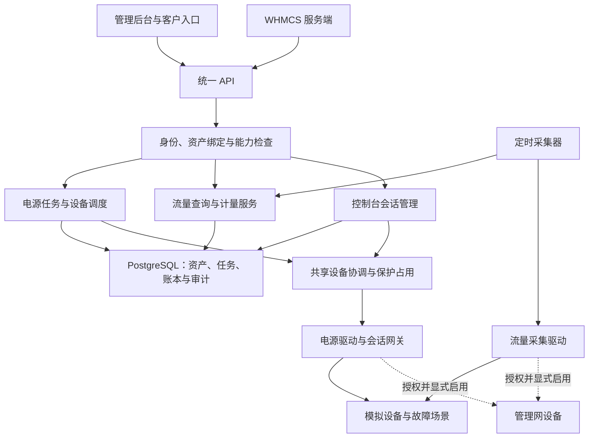
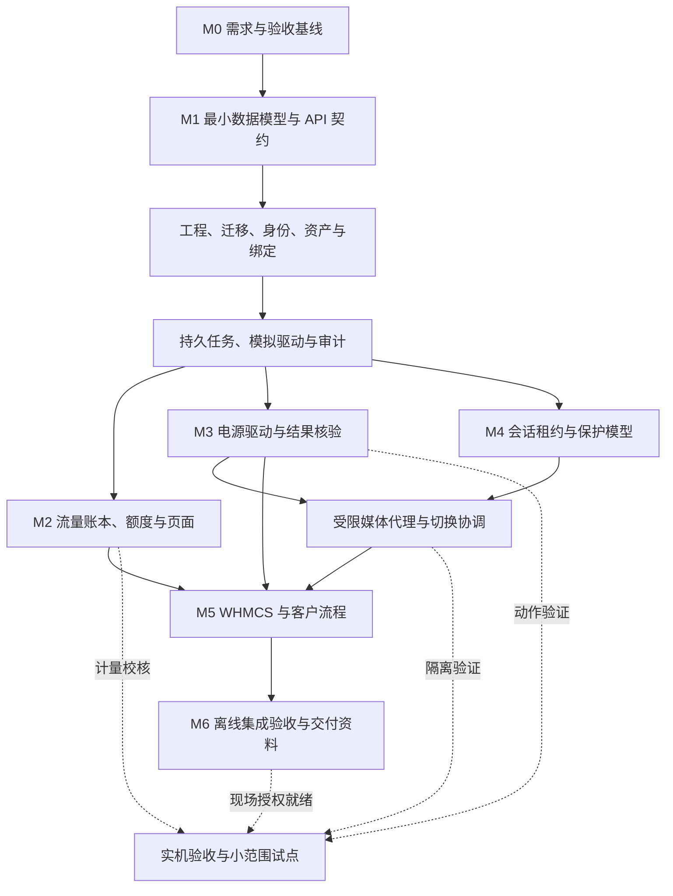
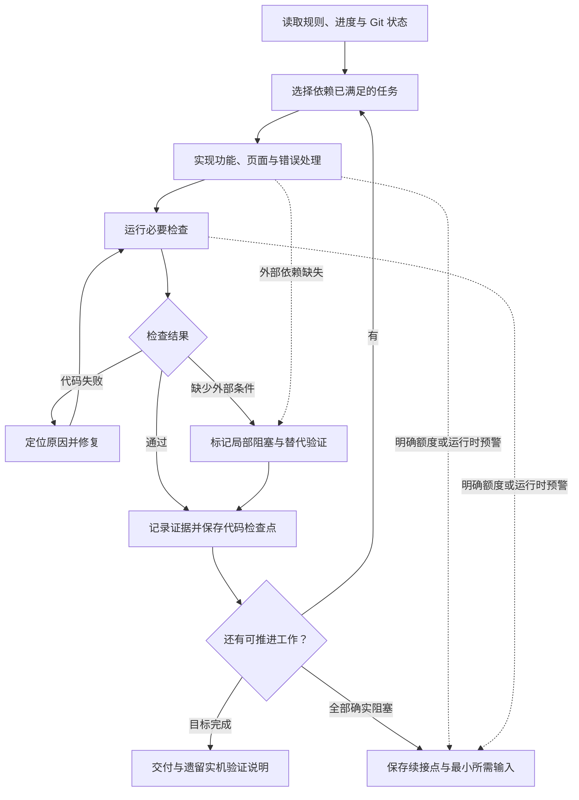

# BarePulse 开发流程与架构图

版本：执行流程 v0.1 · 2026-10-15（Asia/Shanghai）

本文将 [开发计划](development-plan.md) 细化为可持续执行的编码流程。[AGENTS.md](../AGENTS.md) 是仓库级规则，[实现进度](implementation-status.md) 是续接记录，[启动提示词](codex-start-prompt.md) 用于发起编码任务。

当前已进入可运行实现与离线验收阶段；以下图保留架构与实施顺序，实际完成证据见 [实现进度](implementation-status.md) 和 [离线验收矩阵](offline-acceptance.md)。开发任务覆盖 M1–M5 的代码与离线验证，并准备 M6 的交付资料；实机验证和生产启用单独受授权约束。

## 1. 系统运行架构

设备包括 SN2410、VyOS、APC、定制 PiKVM 和 BMC，各自按能力选择驱动。客户只提交平台服务器 ID 和允许的动作；后台解析端口、插座、地址与凭据。

流量查询读取已采集的数据，不因客户刷新页面触发密集设备请求。PiKVM 电源任务和控制台管理共用设备协调机制，装机占用、冷却、租约和清理状态持久化。模拟端点与真实端点分开注册，默认启动只使用模拟驱动。

## 2. 开发阶段依赖与并行安排

依赖图不是要求每一阶段全部结束才开始下一阶段。稳定的数据／接口契约就绪后，流量、电源和会话模型可并行；实际切换协调依赖电源设备调度。WHMCS 可先针对模拟 API 实现，但端到端验收需要对应平台功能齐备。

每个模块同时交付 API、页面、错误处理和必要测试。实机不可达只阻塞对应现场证据，不阻塞模拟开发、前端、WHMCS 或部署资料；未经隔离验证的真实控制台仍不能开放给客户。

## 3. 持续实现与修复循环

检查点可保存通过的功能增量，也可保存明确标记为 WIP 的未完成工作。记录阻塞不等于测试通过；不能把失败改成成功来继续。环境预警可在任意时点触发安全收尾。

默认连续循环，完成一个阶段、一次提交或一条进度更新都不结束整项任务。只有目标完成、用户停止、全部剩余任务确实受外部条件阻塞，或环境明确出现额度／运行限制时才结束当前执行。

## 4. 第一轮具体实现顺序

### M1.1 环境与最小工程

1. 检查已有分支、工作区和程序；本文件不要求重建已完成内容。
2. 使用 `codex/barepulse-implementation` 或用户指定开发分支，保留 `main` 的规划基线。
3. 核对开发环境，选择并锁定实际可用的 Go、PostgreSQL、前端与依赖版本；不要在文档里猜“最新版本”。
4. 建立模块化后端、前端、迁移、开发 Compose、配置示例与 CI 检查入口。默认只连接本地开发依赖。
5. 固定第一批 API：身份、服务器、设备、绑定、模拟电源动作、任务、审计。返回结构、错误码和权限与前端一起确定。

### M1.2 数据与访问权限

先建立需要用到的实体：用户／角色、服务器、设备、绑定、任务、幂等记录和审计；其它表随模块迁移增加，不为等完整数据库设计而停工。

实现管理员安全初始化、登录／退出、会话与角色检查；不提供生产可用的固定默认口令。资产页面支持服务器与设备管理、端口绑定、冲突说明和数据更新时间。

绑定唯一性在数据库和业务层共同保证。任务保存目标与绑定版本，执行前复核；换客户、换端口不能让旧任务落到新服务器上。

### M1.3 模拟电源任务贯通

实现设备能力声明、任务入队、幂等键、设备调度、任务结果与审计。模拟驱动至少支持：成功、设备离线、HTTP 200 内层失败、超时后结果未知和忙碌。

前端可以完成“新增服务器 → 绑定设备 → 查看模拟状态 → 提交动作 → 跟踪结果 → 查看日志”。数据和页面明确是开发示例，不显示虚假的实机在线状态。

M1 通过后自动继续 M2/M3，不要求用户再说“继续”。

## 5. 后续任务拆分和验收门槛

| 阶段 | 必须实现 | 离线验收重点 | 现场验证另记 |
| --- | --- | --- | --- |
| M2 流量 | SNMP 采集接口、计数器归一化、样本、账本、额度、图表 | 独立／共享额度；端口与 VLAN 防重复；复位、漏采、换绑、跨周期、重跑去重 | SN2410／VyOS 可用对象、方向和真实计量口径 |
| M3 电源 | 先 PiKVM HTTP，再按已核对能力实现 APC、IPMI／iDRAC；持久任务、审计、状态核验 | 参数校验、并发领取、重复请求、超时恢复、绑定漂移、未知状态、30 秒冷却 | 实际开关机语义、PDU 供电路径、BMC 能力 |
| M4 控制台 | 设备独占、队列、保护占用、访问票据、白名单代理、旧连接撤销、介质归属 | 两客户竞争；到期／掉线／重启恢复；旧连接和输入残留；未知目标阻断 | 实际视频／Janus／WebRTC 通道及物理目标隔离 |
| M5 WHMCS | 服务映射、客户详情、流量与任务、控制台申请、错误展示 | 模拟 API 契约；服务归属；重放与越权；平台不可用；凭据不泄漏 | 实际 WHMCS 版本、模板、会话及生命周期联调 |
| M6 交付 | 构建、启动、迁移、备份恢复说明；已知限制；可审核 PR | 干净环境启动、关键操作流程、持久化恢复、必要回归 | 指定设备试点及逐台启用 |

设备协议缺少证据时先完成驱动框架、能力声明和可核对部分。无法确认的写操作显式标为不支持／待验证，不猜 OID、动作枚举或用固定成功返回补齐。继续其它任务，不能因此停掉整个项目。

共享控制台不是把设备网页放进 iframe。需要控制所有开放的视频、键鼠与介质路径；对未知的 extras 通道不开放。具体设备陷阱必须遵守 [PiKVM 专篇](pikvm-integration.md)。

## 6. 目录与接口组织建议

以下目录是实现目标，当前未创建的目录不代表代码已存在。已有工程结构出现后可按其调整，避免重复脚手架。

| 路径 | 职责 |
| --- | --- |
| `backend/cmd/` | API 与 worker 入口 |
| `backend/internal/identity/`、`inventory/` | 身份、角色、资产与绑定 |
| `backend/internal/operations/` | 持久任务、幂等、设备调度与恢复 |
| `backend/internal/traffic/` | 采集、归一化、账本与额度 |
| `backend/internal/console/` | 租约、保护占用、网关与介质 |
| `backend/internal/drivers/` | 模拟、PiKVM、APC、BMC 与 SNMP 适配 |
| `backend/migrations/` | 版本化数据库迁移 |
| `frontend/` | 管理与客户页面 |
| `integrations/whmcs/` | WHMCS 模块及模板 |
| `api/` | OpenAPI 与接口示例 |
| `deploy/` | 开发／部署配置，不含真实凭据 |
| `tests/fixtures/` | 脱敏响应、流量样本和异常场景 |
| `docs/` | 规格、执行流程、运行说明和进度 |

首期保持一个统一的领域模型，避免不同驱动各自实现权限、额度或任务状态。平台接口不泄露厂商端口参数；驱动只接收后端已经校验的目标。

## 7. 测试、质量与提交

### 7.1 分层检查

- 单元测试：解析、计算、权限判定与状态转换。
- 契约测试：模拟设备和平台 API 的请求／响应与错误行为。
- PostgreSQL 集成测试：迁移、唯一约束、幂等落库、并发任务领取和恢复；不能以内存实现代替这些证据。
- 页面／端到端检查：资产录入、模拟任务、流量账户、控制台排队与错误提示。
- 跨模块回归：绑定变更、客户权限、worker 重启、会话清理和敏感字段过滤。

M1 需创建统一的检查入口并将实际命令写入 README／运行说明，例如按最终工具提供格式化、静态检查、测试和构建命令。本文不假定 `make verify` 或某个 npm 脚本目前已经存在。

工具缺失时，先尝试环境允许的安装或使用开发容器；无法运行则准确标记阻塞并执行其它可行检查。不得修改安全限制、替换成假依赖或跳过关键断言后宣称通过。

### 7.2 Git 工作方式

按小型、可审核的功能增量提交，提交前检查 diff，避免意外带入凭据或无关文件。有权限时持续推送同一开发分支并更新 PR，无权限时保留本地提交和具体推送阻塞。最终交付为可审核 PR；不强推、不覆盖用户修改、不绕过保护。

每个阶段完成不需要等待合并才继续下一阶段。主线合并与生产部署依据用户授权和仓库规则执行；不能为了“不停下来”而跳过必要权限。

## 8. 持续记录、额度和恢复

### 8.1 持续记录

更新 `docs/implementation-status.md`，至少包括：当前阶段、代码状态、离线／实机验证状态、最新实现提交、关键决定、失败或未运行检查、局部阻塞、下一条可执行任务。对代码和实际环境的观察优先于过时的进度文字。

普通技术选择自行推进；未明确的收费、限速、断网、断电和生产策略通过配置保留，并默认关闭。不要把所有待决项一次性抛给用户，只有确实阻止所有剩余工作的事项才需要中断提问。

### 8.2 额度与运行边界

“持续执行”指当前任务和运行环境允许范围内持续推进，不表示一个提示词可以改变平台时限、权限或额度限制。

只有环境确实提供额度／限流／运行时预警时才据此安排收尾；若可靠读数显示剩余约 10%，可保存检查点后暂停。不能读取额度时如实记录，不猜测，不把上下文压缩误判为账户额度不足。

暂停前尽可能保存工作，记录未提交／未推送改动、已通过及未通过检查、阻塞和准确下一步。未完成工作标记 WIP；以后收到继续任务时恢复，不声称已安排自动唤醒。

### 8.3 完成定义

结束编码轮次时需交付：可运行工程、管理界面、迁移、模拟与已实现设备驱动、关键测试、启动／部署／恢复说明、实际验证证据和清晰的剩余事项。原开发计划中的关键案例应映射到测试或明确的实机待验证项。

“代码完成／离线通过”与“实机验证通过／可以上线”分开报告。全部可推进任务完成后正常交付，不为持续运行增加未约定的功能。

## 9. 执行方式参考

OpenAI 官方资料建议以仓库中的计划、约束、验证步骤和状态记录支撑长任务，并让实现、检查、修复循环推进。本仓库将该方式具体化为上述文件和门槛，而非承诺固定运行时长。

- [AGENTS.md 官方说明](https://learn.chatgpt.com/docs/agent-configuration/agents-md)
- [长任务与持久进度记录](https://developers.openai.com/blog/run-long-horizon-tasks-with-codex)
- [额度查看说明](https://learn.chatgpt.com/docs/pricing)：官方提供用量面板，Codex CLI 可通过交互命令 `/status` 查看；不代表代理在所有环境都能自动读取账户额度。
